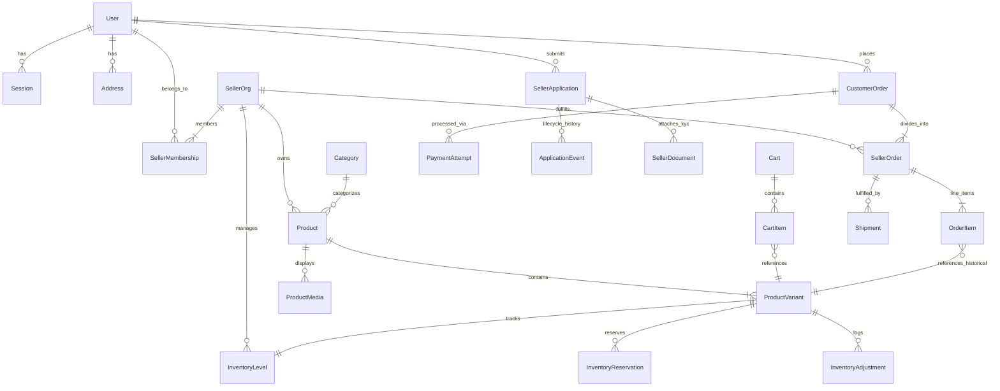

# WIZZ.PK — Data Model & Schema Specification

## 1. Overview & Conventions
The database schema is normalized, relational, and engineered for high transactional integrity on PostgreSQL.

### Core Modeling Principles
1. **Integer Minor Units**: All monetary columns (`priceMinor`, `subtotalMinor`, `taxMinor`, `shippingMinor`, `totalMinor`, `commissionMinor`) are 64-bit integers (`BigInt` or `Int` in Prisma) storing values in minor units (e.g. cents in USD).
2. **First-Party vs Multi-Seller**: Every product belongs to a `SellerOrg`. At inception, `WIZZ.PK` is seeded as the primary 1P seller org (`id: seller_wizz_pk_1p`).
3. **Decoupled User Identity**: A `User` account holds credentials and contact info. Users can be retail buyers and simultaneously members of one or more `SellerOrg`s via `SellerMembership`.
4. **Order Immutability**: Historical orders freeze catalog data via snapshots on `OrderItem` (title, variant name, SKU, seller name, unit price, tax, discount). Catalog mutations never modify past orders.
5. **No Dangerous Cascades**: Critical financial and audit entities (`CustomerOrder`, `SellerOrder`, `OrderItem`, `PaymentAttempt`, `AuditEvent`) preserve their records even if products, categories, or user accounts are disabled or deleted.

---

## 2. Entity Relational Architecture

---

## 3. Entity Definitions

### 3.1 Identity & Access
- **`User`**: System identity. Supports credentials, phone, verification flags, and administrative platform roles:
  - `PLATFORM_SUPER_ADMIN`
  - `PLATFORM_CATALOG_ADMIN`
  - `PLATFORM_FINANCE_ADMIN`
  - `PLATFORM_SUPPORT`
  - `CUSTOMER`
- **`Session`**: Session state with expiry, IP logging, and agent telemetry.
- **`Address`**: Structured customer and seller address book (street, unit, city, province/state, postal code, country code, default flags).

### 3.2 Sellers & Onboarding
- **`SellerOrg`**: Legal merchant organization.
  - Operational statuses: `INACTIVE`, `ACTIVE`, `SUSPENDED`, `CLOSED`.
- **`SellerMembership`**: Maps `User` to `SellerOrg` with role:
  - `OWNER`, `ADMIN`, `CATALOG_MANAGER`, `FULFILLMENT_MANAGER`.
- **`SellerApplication`**: Dedicated pipeline for prospective sellers.
  - Statuses: `DRAFT`, `SUBMITTED`, `UNDER_REVIEW`, `CHANGES_REQUESTED`, `APPROVED`, `REJECTED`.
  - Captures legal entity details, tax identification, contact information, and audit history.
- **`ApplicationEvent`**: Immutable event log tracking status changes, actor user IDs, and review feedback notes.
- **`SellerDocument`**: KYC documents (incorporation certificate, tax certificate, identity proof) stored privately with strict authorization.

### 3.3 Catalog & Taxonomies
- **`Category`**: Hierarchical category tree (parent-child relationships), SEO slug, display order, active status.
- **`Brand`**: Manufacturer or label identity.
- **`Product`**: Base listing belonging to `sellerOrgId`. Statuses: `DRAFT`, `PUBLISHED`, `ARCHIVED`. Dimensional properties (dimensions, weight) for shipping calculations.
- **`ProductVariant`**: Sellable SKU with unique title, SKU string (unique within seller), price in minor units, compare-at price, cost price, and JSON attribute map (e.g. `{"size": "XL", "color": "Navy"}`).
- **`ProductMedia`**: Media assets with aspect ratio, alt text, and thumbnail priority.

### 3.4 Concurrency-Safe Inventory
- **`InventoryLevel`**: Current stock balance (`availableUnits`, `reservedUnits`, `safetyStock`, `lowStockThreshold`).
- **`InventoryReservation`**: Temporary 15-minute checkout holds with `expiresAt`, mapped to `cartId` and `variantId`.
- **`InventoryAdjustment`**: Immutable ledger of stock modifications recording user ID, delta, reason code (`RECEIVING`, `PURCHASE`, `DAMAGE`, `COUNT_CORRECTION`), and before/after balances.

### 3.5 Cart, Orders & Fulfillment
- **`Cart` & `CartItem`**: Persistent customer carts with variant references and quantity validation.
- **`CustomerOrder`**: The overarching order placed by the buyer. Contains totals, shipping/billing address snapshots, overall status (`PENDING_PAYMENT`, `PAID`, `PROCESSING`, `PARTIALLY_SHIPPED`, `SHIPPED`, `DELIVERED`, `CANCELLED`, `REFUNDED`), and payment status (`UNPAID`, `PAID`, `REFUNDED`).
- **`SellerOrder`**: Deconstructed sub-order for each distinct seller organization within a mixed cart. Contains allocated shipping, tax, subtotal, and seller fulfillment status (`CONFIRMED`, `PACKING`, `DISPATCHED`, `DELIVERED`, `CANCELLED`).
- **`OrderItem`**: Frozen record containing `productTitleSnapshot`, `variantNameSnapshot`, `skuSnapshot`, `sellerNameSnapshot`, `unitPriceMinor`, `subtotalMinor`, `discountMinor`, `taxMinor`, `totalMinor`.
- **`Shipment` & `ShipmentEvent`**: Dispatch records with carrier names, tracking numbers, tracking links, and milestone timeline events.

### 3.6 Payments & Financials
- **`PaymentAttempt`**: Transaction attempt record tracking gateway references, idempotency keys, minor unit amounts, and gateway status.
- **`WebhookEvent`**: Idempotent audit record of all incoming webhook payloads, preventing duplicate credits or status overrides.
- **`Refund`**: Recorded refunds tied to customer and seller orders with external payment provider transaction IDs.

### 3.7 Platform Administration & Utilities
- **`AuditEvent`**: Platform-wide audit trail capturing administrative modifications (product approvals, application reviews, role alterations, inventory overrides).
- **`BackgroundJob`**: Resilient job table supporting delayed and recurring background jobs with retry counters, failure logs, and execution timestamps.
- **`PlatformSetting`**: Key-value configuration store for configurable taxes, shipping tiers, brand metadata, and feature flags.

---

## 4. Stage 2 & Stage 3 Schema Evolution (Documented Boundaries)
While Stage 1 focuses on WIZZ.PK direct retail and seller onboarding, the schema explicitly reserves entities for subsequent phases:
- **Stage 2**: `SellerPayoutProfile` (Stripe Connect / provider accounts), `SellerInventoryWarehouse`.
- **Stage 3**: `MarketplaceLedgerEntry` (double-entry accounting for gross sales, platform commission, processor fees, reserves, and payables), `SellerPayoutBatch`, `DisputeCase`.
