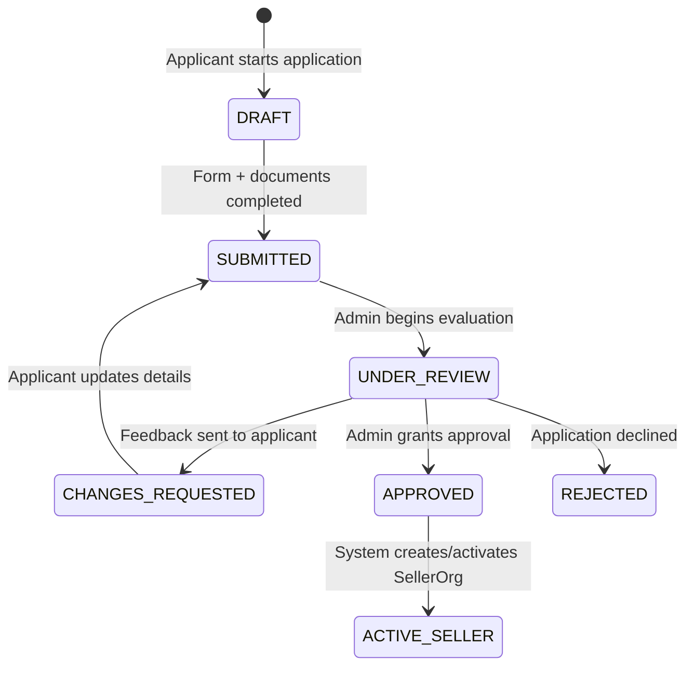

# WIZZ.PK — Access Control & Permissions Matrix

## 1. Overview
Security and tenant isolation in WIZZ.PK are enforced strictly at the service and data-access layers. UI-level visibility toggles are treated purely as visual conveniences; every Server Action, API endpoint, and background routine rigorously asserts authorization rules before reading or mutating state.

---

## 2. Platform Roles & Privileges

| Permission Scope | `PLATFORM_SUPER_ADMIN` | `PLATFORM_CATALOG_ADMIN` | `PLATFORM_FINANCE_ADMIN` | `PLATFORM_SUPPORT` | `CUSTOMER` |
| :--- | :---: | :---: | :---: | :---: | :---: |
| **Manage Platform Users & Roles** | Yes | No | No | No | No |
| **System Settings & Feature Flags** | Yes | No | No | No | No |
| **Review & Approve Seller Applications** | Yes | No | No | Yes (View Only) | No |
| **WIZZ.PK 1P Catalog & Taxonomy** | Yes | Yes | No | View Only | View Published |
| **Moderate 3P Listings** | Yes | Yes | No | No | No |
| **Manage Inventory Adjustments** | Yes | Yes | No | View Only | No |
| **Process Refunds & Payment Adjustments**| Yes | No | Yes | No | No |
| **View Audit Trails** | Yes | No | Yes | No | No |
| **View / Manage Customer Orders** | Yes | No | Yes | Yes | Own Orders Only|
| **Submit Verified Reviews** | Yes | No | No | No | Own Purchases |

---

## 3. Seller Organization Roles (Multi-Tenant Isolation)

Every approved seller operates within a sandboxed `SellerOrg`. Users assigned to a seller org hold one of the following memberships:

| Seller Capability | `OWNER` | `ADMIN` | `CATALOG_MANAGER` | `FULFILLMENT_MANAGER` |
| :--- | :---: | :---: | :---: | :---: |
| **Edit Store Profile & Public Branding** | Yes | Yes | No | No |
| **Manage Staff Memberships & Invites** | Yes | Yes | No | No |
| **Create & Edit Seller Product Listings** | Yes | Yes | Yes | No |
| **Adjust Stock Levels & Receive Goods** | Yes | Yes | Yes | No |
| **View Seller Orders & Customer Details**| Yes | Yes | No | Yes |
| **Assign Carrier & Dispatch Shipments** | Yes | Yes | No | Yes |
| **Inspect Returns & Restock Items** | Yes | Yes | No | Yes |
| **View Financial Statements & Payouts** | Yes | View Only | No | No |

### Tenant Isolation Rules
1. **Cross-Tenant Access Prohibited**: A seller query always filters by `sellerOrgId`. A member of Seller A attempting to query or update an order, listing, or file belonging to Seller B receives an immediate `FORBIDDEN` exception.
2. **Customer Privacy Masking**: Seller order views display only data necessary to fulfill the package (shipping address, recipient name, item details). Customer billing details, payment card tokens, and unrelated items from other sellers in the same customer order are strictly omitted.

---

## 4. Seller Application Lifecycle & Access Restrictions

### Applicant Policy Rules
1. **Application Tracking**: While an application is in `DRAFT`, `SUBMITTED`, `UNDER_REVIEW`, or `CHANGES_REQUESTED`, the user can authenticate and access the Onboarding Workspace.
2. **Zero Listing Permissions**: Applicants cannot access catalog management, create listings, or receive orders prior to administrative approval (`APPROVED`) and operational activation (`ACTIVE`).
3. **Private Document Protection**: Uploaded business documents (certificates, tax filings, identity proofs) are inaccessible to other users and are served only to the applicant and platform admins via signed URLs.
